# SMAact4_t4 — API REST con Spring Boot, Spring Security y JWT

| | |
|---|---|
| **Alumno** | Angel Sixto Morales (SMA) |
| **Materia** | Programación Web — Ing. Adelina Martínez Nieto |
| **Grupo** | 7SD — Instituto Tecnológico de Oaxaca (TecNM) |
| **Actividad** | Act4. API REST con Spring Boot, Spring Security y JWT (sin frontend) |
| **URL base de la API (VPS)** | **http://157.180.30.55:8086/api** |
| **Colección de Bruno** | [`/bruno`](bruno/) |

---

## Índice

1. [Descripción](#1-descripción)
2. [Requisitos de la actividad y dónde se cumplen](#2-requisitos-de-la-actividad-y-dónde-se-cumplen)
3. [Tecnologías](#3-tecnologías)
4. [Arquitectura del proyecto](#4-arquitectura-del-proyecto)
5. [Autenticación con Spring Security + JWT](#5-autenticación-con-spring-security--jwt)
6. [Endpoints](#6-endpoints)
7. [DTOs y validación](#7-dtos-y-validación)
8. [Códigos de estado HTTP](#8-códigos-de-estado-http)
9. [Colección de Bruno](#9-colección-de-bruno)
10. [Evidencias (capturas)](#10-evidencias-capturas)
11. [Ejecutar en local](#11-ejecutar-en-local)
12. [Despliegue en el VPS](#12-despliegue-en-el-vps)
13. [Cuestionario](#13-cuestionario)

---

## 1. Descripción

API REST pura (solo JSON, sin vistas Thymeleaf) para administrar **alumnos** y sus **carreras**,
retomando las entidades y la relación de la Actividad 3. Está conectada a **MySQL** y protegida con
**Spring Security + JWT**:

1. El usuario se **registra** (`/api/auth/register`) o hace **login** (`/api/auth/login`) y recibe un **token JWT**.
2. Para usar el CRUD debe enviar ese token en cada petición:
   `Authorization: Bearer <token>`.
3. Si no envía token, o el token es falso o expiró, la API responde **401 Unauthorized**.

Usa **DTOs** para todo lo que entra y sale (nunca expone entidades ni el password), **valida** los datos
con `@Valid` y regresa **códigos HTTP correctos** con `ResponseEntity`. Se prueba y documenta con **Bruno**.

---

## 2. Requisitos de la actividad y dónde se cumplen

| Requisito | Dónde se cumple |
|---|---|
| Rutas REST que regresan siempre JSON | Todos los controladores son `@RestController`; los errores también son JSON (`GlobalExceptionHandler`, `JsonAuthenticationEntryPoint`) |
| Verbos HTTP correctos | `GET` listar/ver, `POST` crear, `PUT` actualizar, `DELETE` eliminar |
| Códigos 200, 201, 400, 401, 404 con `ResponseEntity` | Controladores + `GlobalExceptionHandler` (ver sección 8) |
| DTOs de entrada y salida, sin exponer el password | Paquete `dto` (`*Request` / `*Response`); `UsuarioResponse` no tiene password |
| Validación con `@Valid` y Bean Validation | `@Valid` en los controladores; `@NotBlank`, `@Email`, `@Size`, `@Pattern`, `@Min`, `@Max`, `@NotNull`, `@Positive` en los DTOs |
| Spring Security configurado | `config/SecurityConfig.java` |
| Generar y validar JWT reales | `security/JwtService.java` (genera), `JwtDecoder` en `SecurityConfig` (valida firma, expiración y emisor) |
| `/api/auth/register` y `/api/auth/login` regresan un token | `controllers/AuthController.java` |
| CRUD protegido con filtro de seguridad | `oauth2ResourceServer().jwt()` activa el filtro `BearerTokenAuthenticationFilter`; todo excepto register/login requiere token |
| a) GET listar **con paginación** y GET uno | `GET /api/alumnos?page=&size=&sort=` y `GET /api/alumnos/{id}` |
| b) POST crear | `POST /api/alumnos` (201 + header `Location`) |
| c) PUT actualizar | `PUT /api/alumnos/{id}` |
| d) DELETE eliminar | `DELETE /api/alumnos/{id}` (204) |
| Colección de Bruno con registro, login, CRUD y petición sin token | Carpeta [`/bruno`](bruno/) |
| Credenciales fuera del repositorio | `db.properties` en `.gitignore` (sección 11) |
| Puerto nuevo en el VPS | **8086** (sección 12) |

---

## 3. Tecnologías

| Tecnología | Uso |
|---|---|
| Java 17 · Spring Boot · Maven | Base del proyecto |
| Spring Web | Controladores REST |
| Spring Data JPA (Hibernate) + MySQL Driver | Persistencia en MySQL |
| **Spring Security** | Autenticación y protección de endpoints |
| **OAuth2 Resource Server (Nimbus JOSE + JWT)** | Generar (`JwtEncoder`) y validar (`JwtDecoder`) los JWT firmados con HS256 |
| **BCrypt** | Cifrado de passwords |
| **Validation (Hibernate Validator)** | `@Valid`, `@NotBlank`, `@Email`... |
| MySQL 8 · MySQL Workbench | Base de datos |
| **Bruno** | Probar y documentar la API |

---

## 4. Arquitectura del proyecto

```
Cliente (Bruno)
     │  Authorization: Bearer <token>
     ▼
┌──────────────────────────────────────────────┐
│ SPRING SECURITY (cadena de filtros)          │
│  BearerTokenAuthenticationFilter → JwtDecoder │  ← sin token / token inválido → 401 JSON
└──────────────────────────────────────────────┘
     ▼
CONTROLLER  (@RestController, @Valid, ResponseEntity)   ← recibe DTOs *Request
     ▼
SERVICE     (lógica de negocio, @Transactional)          ← convierte Entity ⇄ DTO
     ▼
REPOSITORY  (JpaRepository, paginación)
     ▼
MySQL  (usuarios, carreras, alumnos)
```

```
src/main/java/mx/edu/itoaxaca/smaact4/
├── config/
│   └── SecurityConfig.java              # Spring Security, JWT encoder/decoder, BCrypt
├── security/
│   ├── JwtService.java                  # Genera los tokens JWT
│   └── JsonAuthenticationEntryPoint.java# Respuesta 401 en JSON
├── models/entity/                       # ENTIDADES (tablas)
│   ├── Usuario.java · Rol.java
│   ├── Carrera.java                     # 1 ──< N
│   └── Alumno.java                      # @ManyToOne carrera_id (FK)
├── dto/                                 # DTOs (lo que entra y sale de la API)
│   ├── auth/      RegisterRequest, LoginRequest, AuthResponse, UsuarioResponse
│   ├── alumno/    AlumnoRequest, AlumnoResponse
│   ├── carrera/   CarreraRequest, CarreraResponse
│   └── common/    PageResponse, ErrorResponse
├── repository/                          # UsuarioRepository, CarreraRepository, AlumnoRepository
├── service/                             # AuthService, CarreraService, AlumnoService
├── controllers/                         # AuthController, CarreraController, AlumnoController
└── exception/                           # GlobalExceptionHandler + excepciones propias
bruno/                                   # Colección de Bruno (versionada en Git)
database/                                # Script SQL
db.properties.example                    # Plantilla de credenciales (la real no se sube)
```

**Modelo de datos:**

```
usuarios                carreras (1) ─────────< (N) alumnos
┌───────────────┐       ┌────────────┐            ┌─────────────────────┐
│ id (PK)       │       │ id (PK)    │            │ id (PK)             │
│ nombre        │       │ clave (UQ) │            │ numero_control (UQ) │
│ email (UQ)    │       │ nombre     │            │ nombre, apellidos   │
│ password      │ ← hash BCrypt       │            │ email, semestre     │
│ rol           │       └────────────┘            │ carrera_id (FK) ────┼─► carreras.id
│ fecha_registro│                                 └─────────────────────┘
└───────────────┘
```

---

## 5. Autenticación con Spring Security + JWT

### 5.1 Flujo

```
1) REGISTRO / LOGIN
   Bruno ── POST /api/auth/login {email, password} ──► AuthController
                                                        │
                       AuthenticationManager ◄──────────┘ compara el password con el hash BCrypt
                                │ correcto
                       JwtService.generarToken() ──► firma el JWT con HS256 + clave secreta
   Bruno ◄── 200 {token, tipo:"Bearer", expiraEnSegundos, usuario} ──┘

2) PETICIÓN PROTEGIDA
   Bruno ── GET /api/alumnos  +  Authorization: Bearer eyJhbGciOi... ──►
            BearerTokenAuthenticationFilter extrae el token
            JwtDecoder verifica: ✔ firma  ✔ no expirado  ✔ emisor = smaact4-api
              ├─ válido   → la petición llega al AlumnoController → 200
              └─ inválido / sin token → JsonAuthenticationEntryPoint → 401 JSON
```

### 5.2 Configuración (`SecurityConfig`)

```java
http
    .csrf(csrf -> csrf.disable())                                   // API sin cookies
    .sessionManagement(s -> s.sessionCreationPolicy(STATELESS))     // sin sesiones: solo el token
    .authorizeHttpRequests(auth -> auth
        .requestMatchers(HttpMethod.POST, "/api/auth/register", "/api/auth/login").permitAll()
        .anyRequest().authenticated())                              // todo lo demás exige JWT
    .oauth2ResourceServer(oauth2 -> oauth2.jwt(Customizer.withDefaults())) // filtro que valida el JWT
    .exceptionHandling(ex -> ex.authenticationEntryPoint(entryPoint));      // 401 en JSON
```

- **`PasswordEncoder` (BCrypt):** el password se guarda como hash (`$2a$10$...`), nunca en texto plano.
- **`UserDetailsService`:** busca al usuario por email en MySQL.
- **`AuthenticationManager` + `DaoAuthenticationProvider`:** verifica email y password en el login.
- **`JwtEncoder` (`NimbusJwtEncoder`):** firma los tokens con la clave secreta (HMAC-SHA256).
- **`JwtDecoder` (`NimbusJwtDecoder`):** valida la firma, la expiración (`exp`) y el emisor (`iss`).

### 5.3 Contenido del token

Un JWT tiene 3 partes separadas por puntos: `HEADER.PAYLOAD.FIRMA`. El payload de esta API contiene:

```json
{
  "iss": "smaact4-api",
  "sub": "angel.sixto@example.com",
  "uid": 1,
  "nombre": "Angel Sixto Morales",
  "rol": "USER",
  "iat": 1794600000,
  "exp": 1794603600
}
```

El token expira en **60 minutos** (`jwt.expiracion-minutos`). Se puede decodificar en https://jwt.io
para ver su contenido, pero **no se puede modificar** sin invalidar la firma.

---

## 6. Endpoints

URL base local: `http://localhost:8080` · VPS: `http://157.180.30.55:8086`

### Autenticación (públicos)

| Método | Ruta | Body | Respuesta |
|---|---|---|---|
| POST | `/api/auth/register` | `{nombre, email, password}` | **201** + token · 400 · 409 (email repetido) |
| POST | `/api/auth/login` | `{email, password}` | **200** + token · 400 · 401 (credenciales incorrectas) |
| GET | `/api/auth/perfil` 🔒 | — | 200 datos del usuario del token |

### CRUD de Alumnos 🔒 (requiere `Authorization: Bearer <token>`)

| | Método | Ruta | Respuesta |
|---|---|---|---|
| a) Listar **paginado** | GET | `/api/alumnos?page=0&size=5&sort=apellidos,asc` (opcional `&carreraId=1`) | 200 |
| a) Ver uno | GET | `/api/alumnos/{id}` | 200 · 404 |
| b) Crear | POST | `/api/alumnos` | **201** + `Location` · 400 · 409 |
| c) Actualizar | PUT | `/api/alumnos/{id}` | 200 · 400 · 404 · 409 |
| d) Eliminar | DELETE | `/api/alumnos/{id}` | **204** · 404 |

### Carreras 🔒

| Método | Ruta | Respuesta |
|---|---|---|
| GET | `/api/carreras` | 200 |
| GET | `/api/carreras/{id}` | 200 · 404 |
| POST | `/api/carreras` | 201 · 400 · 409 |
| PUT | `/api/carreras/{id}` | 200 · 400 · 404 · 409 |
| DELETE | `/api/carreras/{id}` | 204 · 404 · 409 (tiene alumnos) |

### Ejemplos

**Login → 200 OK**
```json
{
  "token": "eyJhbGciOiJIUzI1NiJ9.eyJpc3MiOiJzbWFhY3Q0LWFwaSIs...",
  "tipo": "Bearer",
  "expiraEnSegundos": 3600,
  "usuario": {
    "id": 1,
    "nombre": "Angel Sixto Morales",
    "email": "angel.sixto@example.com",
    "rol": "USER",
    "fechaRegistro": "2026-11-12T19:30:00"
  }
}
```

**Listado paginado → 200 OK**
```json
{
  "contenido": [
    {
      "id": 1,
      "numeroControl": "21160100",
      "nombre": "Angel",
      "apellidos": "Sixto Morales",
      "email": "angel.sixto@example.com",
      "semestre": 7,
      "carrera": { "id": 1, "clave": "ISC", "nombre": "Ingenieria en Sistemas Computacionales" }
    }
  ],
  "pagina": 0,
  "tamanio": 5,
  "totalElementos": 1,
  "totalPaginas": 1,
  "primera": true,
  "ultima": true
}
```

---

## 7. DTOs y validación

La API **nunca recibe ni regresa entidades**. Cada operación usa un DTO:

| DTO | Tipo | Para qué |
|---|---|---|
| `RegisterRequest` | Entrada | nombre, email, password (8 a 64 caracteres) |
| `LoginRequest` | Entrada | email, password |
| `AuthResponse` | Salida | token, tipo, expiración, usuario |
| `UsuarioResponse` | Salida | datos del usuario **sin password** |
| `AlumnoRequest` | Entrada | datos del alumno + `carreraId` |
| `AlumnoResponse` | Salida | datos del alumno + objeto `carrera` |
| `CarreraRequest` / `CarreraResponse` | Entrada / Salida | clave y nombre |
| `PageResponse<T>` | Salida | página de resultados |
| `ErrorResponse` | Salida | formato único de error |

**Validaciones de `AlumnoRequest`:**

```java
@NotBlank @Pattern(regexp = "\\d{8}")  String numeroControl;  // 8 dígitos
@NotBlank @Size(max = 60)              String nombre;
@NotBlank @Size(max = 80)              String apellidos;
@Email @Size(max = 120)                String email;
@NotNull @Min(1) @Max(14)              Integer semestre;
@NotNull @Positive                     Long carreraId;
```

El controlador las activa con `@Valid @RequestBody AlumnoRequest request`.
Si algo falla, responde **400** indicando el error de cada campo:

```json
{
  "timestamp": "2026-11-12T19:35:10.123-06:00",
  "status": 400,
  "error": "Bad Request",
  "mensaje": "La validacion de los datos fallo",
  "ruta": "/api/alumnos",
  "errores": {
    "numeroControl": "El numero de control debe tener exactamente 8 digitos",
    "nombre": "El nombre es obligatorio",
    "email": "El email no tiene un formato valido",
    "semestre": "El semestre maximo es 14",
    "carreraId": "El id de la carrera es obligatorio"
  }
}
```

---

## 8. Códigos de estado HTTP

| Código | Cuándo lo regresa la API |
|---|---|
| **200 OK** | GET exitoso, login, PUT exitoso |
| **201 Created** | Registro, crear alumno o carrera (con header `Location`) |
| **204 No Content** | DELETE exitoso |
| **400 Bad Request** | Falla `@Valid`, JSON mal formado, tipo incorrecto, carrera inexistente en el body |
| **401 Unauthorized** | Sin token, token falso o expirado, login con credenciales incorrectas |
| **404 Not Found** | El alumno o carrera no existe, o la ruta no existe |
| **405 Method Not Allowed** | Verbo no permitido en esa ruta |
| **409 Conflict** | Email, número de control o clave repetidos; borrar una carrera con alumnos |
| **500 Internal Server Error** | Error no previsto |

Todos los errores tienen el mismo formato JSON (`ErrorResponse`).

---

## 9. Colección de Bruno

La colección está en la carpeta [`/bruno`](bruno/) y se versiona junto con el código.

```
bruno/
├── bruno.json
├── collection.bru
├── environments/
│   ├── Local.bru            # baseUrl = http://localhost:8080
│   └── VPS.bru              # baseUrl = http://157.180.30.55:8086
├── 1-Auth/                  # 1. Registro · 2. Login · 3. Perfil (protegido)
├── 2-Carreras/              # 1. Crear carrera · 2. Listar carreras
├── 3-Alumnos/               # 1. POST · 2. GET paginado · 3. GET por id · 4. PUT · 5. DELETE
└── 4-Pruebas de seguridad y errores/
    ├── 1. Listar SIN token (401)
    ├── 2. Token invalido (401)
    ├── 3. Login incorrecto (401)
    ├── 4. Validacion fallida (400)
    ├── 5. Alumno no encontrado (404)
    └── 6. Registro con datos invalidos (400)
```

- El **Login** (y el Registro) guarda automáticamente el token en la variable `{{token}}` con un script post-response.
- Las peticiones protegidas usan **Auth → Bearer Token → `{{token}}`**.
- *Crear carrera* guarda `{{carreraId}}` y *Crear alumno* guarda `{{alumnoId}}`.
- Cada petición tiene **tests** que comprueban el código de estado esperado.

**Cómo usarla:** Bruno → *Open Collection* → carpeta `bruno` → elegir el entorno **Local** o **VPS**
(arriba a la derecha) → ejecutar las peticiones en orden.

---

## 10. Evidencias (capturas)

### Autenticación

**Registro (201 Created + token):**
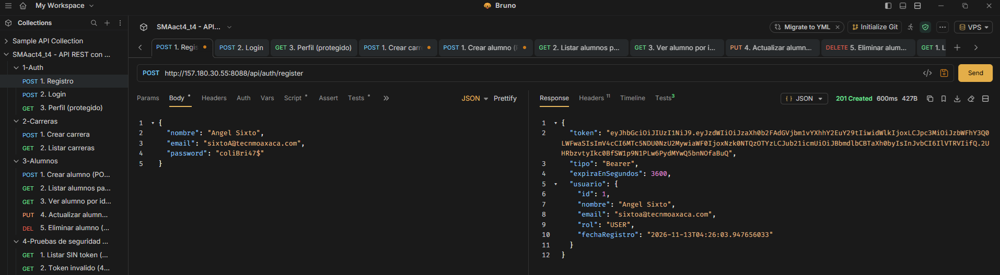

**Login (200 OK + token):**
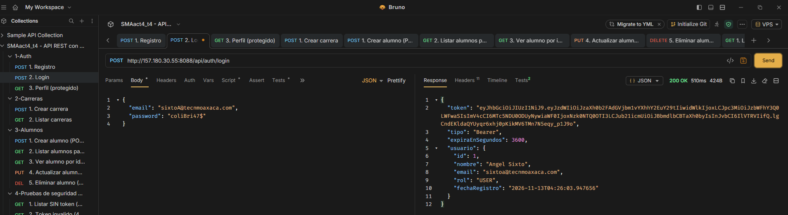

**Contenido del token decodificado:**
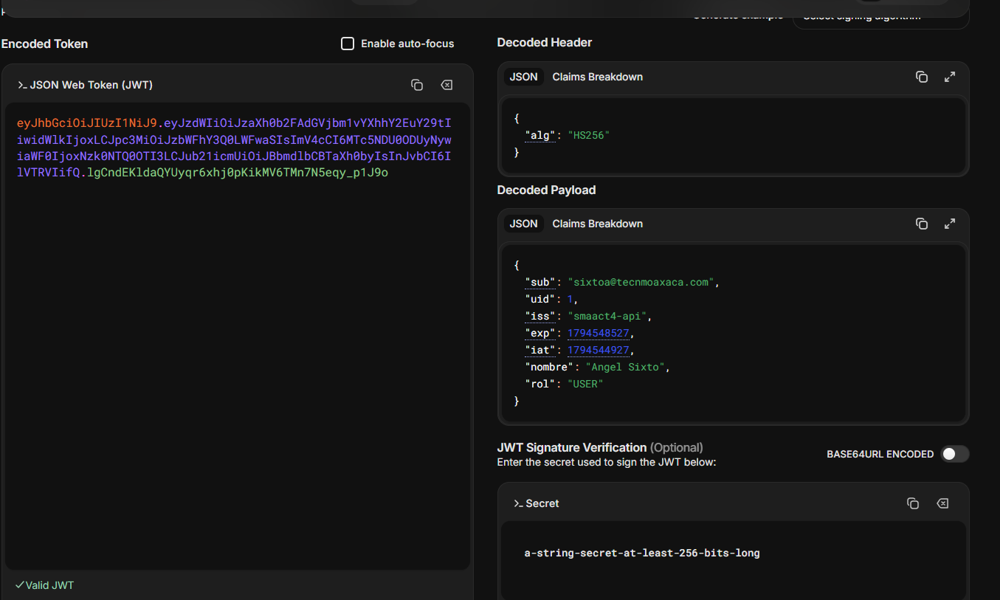

### CRUD con token

**POST: crear alumno (201 Created):**
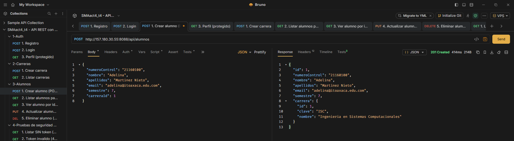

**GET: listar con paginación (200 OK):**
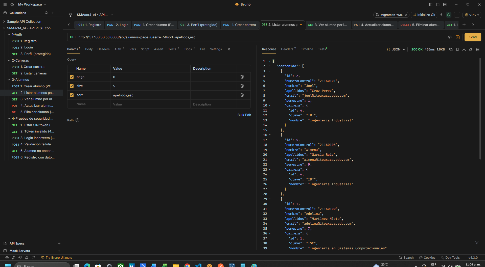

**GET: ver un alumno (200 OK):**
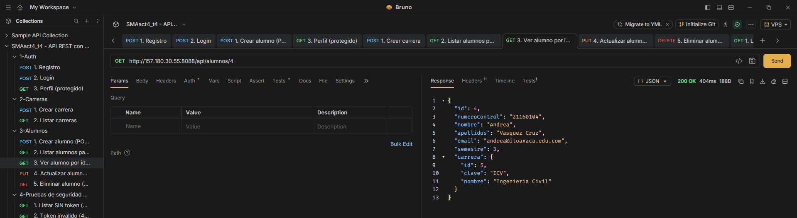

**PUT: actualizar alumno (200 OK):**
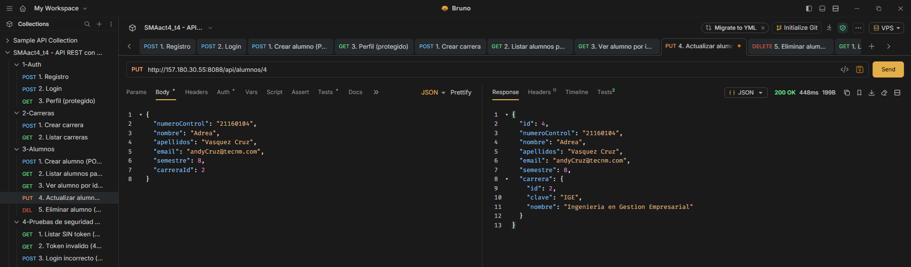

**DELETE: eliminar alumno (204 No Content):**
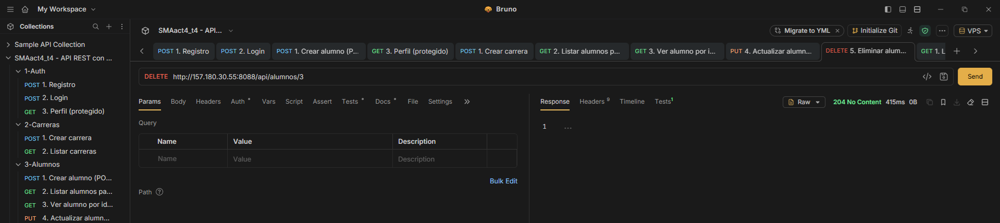

### Seguridad y validación

**Endpoint protegido SIN token (401 Unauthorized):**
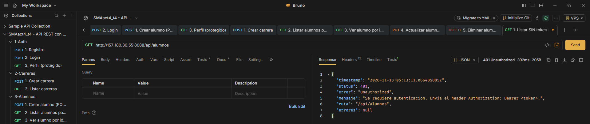

**Validación fallida (400 Bad Request):**
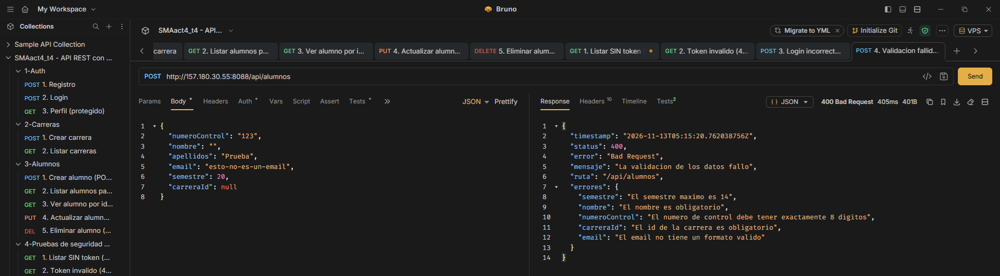

**Password guardado como hash BCrypt en MySQL:**
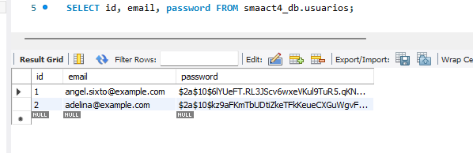

### VPS

**Colección ejecutada contra el VPS:**


**Las cuatro actividades corriendo en el VPS:**


---

## 11. Ejecutar en local

**Requisitos:** JDK 17 o superior, MySQL 8 y Bruno.

1. Crear `db.properties` en la raíz del proyecto (copiar `db.properties.example`):
   ```properties
   spring.datasource.username=root
   spring.datasource.password=TU_PASSWORD
   jwt.secret=UNA_CLAVE_LARGA_DE_MAS_DE_32_CARACTERES
   ```
   `db.properties` está en `.gitignore`: las credenciales y la clave JWT **no se suben a GitHub**.
2. Ejecutar:
   ```bash
   ./mvnw spring-boot:run          # Windows: .\mvnw spring-boot:run
   ```
   La base `smaact4_db` se crea sola (`createDatabaseIfNotExist=true`) y Hibernate crea las tablas.
3. Abrir la colección de Bruno con el entorno **Local**.

---

## 12. Despliegue en el VPS

La API corre en su **propio puerto (8086)** y **carpeta (`/root/smaact4`)**, sin afectar a las actividades anteriores:

| Actividad | Carpeta | Puerto |
|---|---|---|
| Act. 1 | `/root/smaact1` | 8082 |
| Act. 2 | `/root/smaact2` | 8084 |
| Act. 3 | `/root/smaact3` | 8085 |
| **Act. 4** | **`/root/smaact4`** | **8086** |

```bash
# En la PC
./mvnw clean package -DskipTests
scp target/smaact4-0.0.1-SNAPSHOT.jar root@157.180.30.55:/root/smaact4/

# En el VPS (con /root/smaact4/db.properties creado con las credenciales del VPS)
cd /root/smaact4
nohup java -Xmx256m -jar smaact4-0.0.1-SNAPSHOT.jar --server.port=8086 > app.log 2>&1 &
```

En el VPS se usa una base (`smaact4_db`) y un usuario de MySQL propios, y una clave JWT distinta a la local.

---

## 13. Cuestionario

### a) ¿Qué es un JWT y qué información contiene normalmente?

Un **JWT (JSON Web Token)** es un estándar abierto (RFC 7519) para transmitir información de forma
compacta y segura entre dos partes como un texto codificado en Base64URL. Está **firmado digitalmente**:
el servidor puede verificar que no fue alterado y que él mismo lo emitió. Por eso sirve para autenticar
sin guardar sesiones: el cliente lo envía en cada petición en el header `Authorization: Bearer <token>`.

Tiene tres partes separadas por puntos (`header.payload.firma`):

1. **Header:** el tipo de token y el algoritmo de firma. En esta API: `{"alg": "HS256"}`.
2. **Payload (claims):** los datos.
   - Claims estándar: `sub` (sujeto: a quién pertenece, aquí el email), `iss` (quién lo emitió),
     `iat` (cuándo se emitió), `exp` (cuándo expira).
   - Claims personalizados: en esta API `uid`, `nombre` y `rol`.
3. **Firma:** se calcula con el header, el payload y una **clave secreta** que solo conoce el servidor
   (HMAC-SHA256). Si alguien cambia un solo carácter del payload, la firma deja de coincidir y el token se rechaza.

El payload **no está cifrado**, solo codificado: cualquiera puede leerlo (por ejemplo en jwt.io). Por eso
**nunca se guardan datos sensibles** como el password dentro del token.

### b) ¿Cómo protege Spring Security tus endpoints? ¿Qué pasa si intentas llamar uno protegido sin token?

Spring Security funciona como una **cadena de filtros** que se ejecuta **antes** de que la petición llegue
al controlador. En `SecurityConfig` definí un `SecurityFilterChain` con estas reglas:

- `POST /api/auth/register` y `POST /api/auth/login` son **públicos** (`permitAll()`).
- **Cualquier otra ruta** requiere estar autenticado (`anyRequest().authenticated()`).
- La API es **stateless**: no hay sesiones ni cookies, cada petición se autentica solo con su token.
- `oauth2ResourceServer().jwt()` activa el filtro **`BearerTokenAuthenticationFilter`**. Este filtro toma el
  header `Authorization: Bearer <token>` y se lo pasa al **`JwtDecoder`**, que verifica la **firma** con la
  clave secreta, que el token **no haya expirado** y que el **emisor** sea `smaact4-api`. Si todo es correcto,
  registra al usuario como autenticado y la petición continúa al controlador.

**Sin token**, o con un token falso o expirado, la petición **nunca llega al controlador**: el filtro la
detiene y mi `JsonAuthenticationEntryPoint` responde **401 Unauthorized** en JSON, con el header
`WWW-Authenticate: Bearer`. Por ejemplo:
`"Se requiere autenticacion. Envia el header Authorization: Bearer <token>."`.
Esto se comprueba en Bruno con la petición *Listar SIN token (401)*.

Además, los passwords se guardan cifrados con **BCrypt**, y en el login el `AuthenticationManager` compara
el password recibido con ese hash. Si no coincide, responde 401.

### c) ¿Por qué usaste un DTO en vez de exponer directamente tu Entity en las respuestas de la API?

1. **Seguridad:** la entidad `Usuario` contiene el **password** (aunque sea el hash). Con `UsuarioResponse`
   ese campo simplemente no existe, así que es imposible que se filtre por error.
2. **Controlar lo que entra:** con `AlumnoRequest` el cliente solo puede enviar los campos permitidos.
   No puede mandar un `id` o cambiar campos internos (*mass assignment*), y de la carrera solo manda `carreraId`.
3. **Validación:** las reglas de entrada (`@NotBlank`, `@Email`, `@Pattern`, `@Min`...) se definen en el DTO
   y se activan con `@Valid`, sin mezclarlas con el mapeo a la base de datos.
4. **Evitar problemas de JPA:** si se serializa la entidad directamente, la relación bidireccional
   Carrera ⇄ Alumno genera un **ciclo infinito** en el JSON, y las relaciones *lazy* pueden causar errores.
   El DTO regresa solo lo necesario, por ejemplo la carrera como `{id, clave, nombre}`.
5. **Desacoplar la API de la base de datos:** puedo cambiar las tablas o entidades sin romper el contrato
   (formato JSON) que usan los clientes de la API.

### d) Enlaces

- **Repositorio de GitHub (README + colección de Bruno):** https://github.com/TU_USUARIO/SMAact4_t4
- **Colección de Bruno:** https://github.com/TU_USUARIO/SMAact4_t4/tree/main/bruno
- **URL base de la API en el VPS:** http://157.180.30.55:8086/api
  - Login: `POST http://157.180.30.55:8086/api/auth/login`
  - Alumnos: `GET http://157.180.30.55:8086/api/alumnos` (con token)
